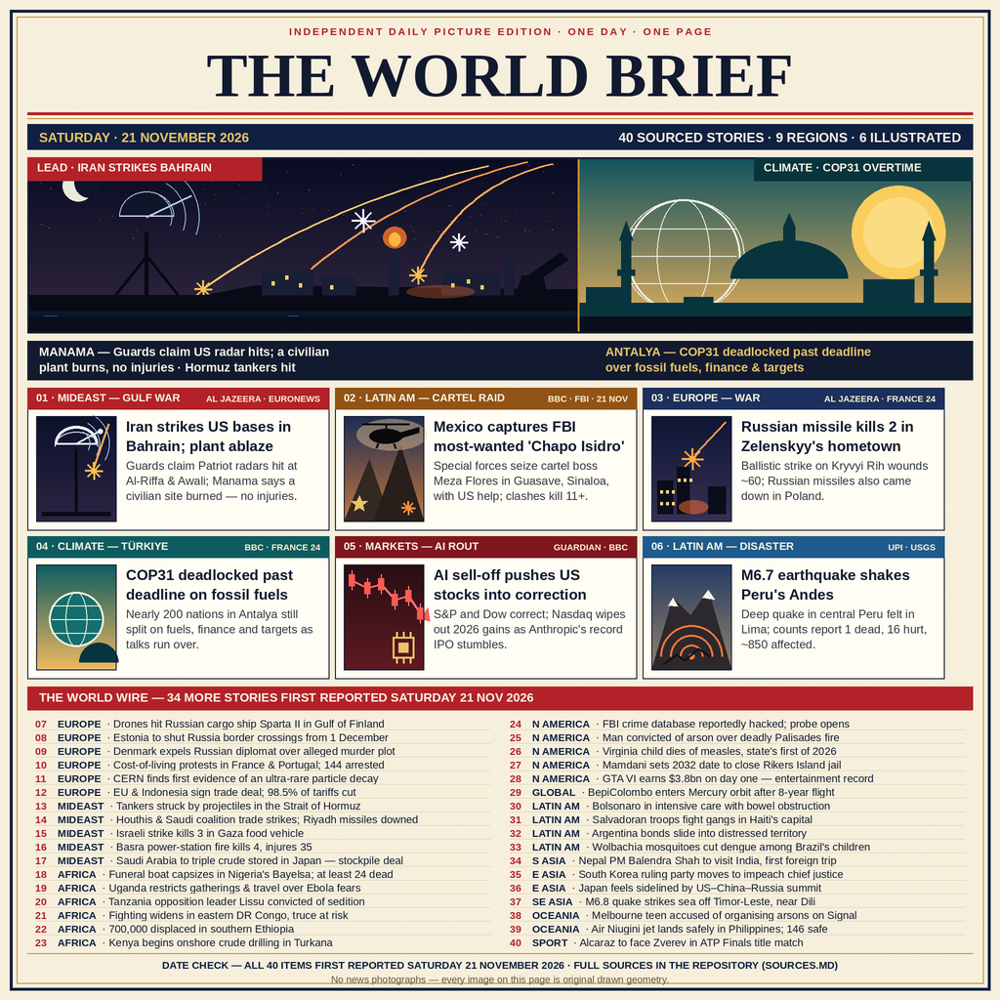

# The World Brief — Saturday 21 November 2026: 40 sourced stories, 9 regions, 6 illustrated

An original editorial front-page poster for [make.fun](https://make.fun/bounty/news-image-20261121): one day of world news — Saturday, 21 November 2026 — summed up in a single 1024 × 1024 image. Six lead stories are illustrated with drawn geometry; a World Wire column adds 34 more dated stories across nine regions. The poster contains no news photography; every illustration is original vector-style geometry drawn by `render.py` (Pillow, deterministic, supersampled 2048 → 1024). Full source list: see `SOURCES.md`.

## The six illustrated stories

1. **Bahrain / Gulf.** Iran's Revolutionary Guards claimed missile and drone strikes on US positions in Bahrain (Patriot radars at Al-Riffa and Awali); Bahrain said a civilian industrial facility was hit and caught fire, with no injuries, and that its air defences intercepted other attacks. (Al Jazeera, Euronews, 21 Nov 2026)
2. **Mexico.** Special forces captured Fausto Isidro Meza Flores — "Chapo Isidro", on the FBI's Ten Most Wanted list — in Guasave, Sinaloa, with US assistance; the violence that followed left at least 11 dead. (BBC, CBS, FBI announcement, 21 Nov 2026)
3. **Ukraine.** A Russian ballistic missile hit the centre of Kryvyi Rih, President Zelenskyy's hometown, killing two people — one a 7-year-old boy — and wounding roughly 60; Russian missiles had also come down in Poland. (Al Jazeera, France 24, 21 Nov 2026)
4. **COP31, Türkiye.** The UN climate summit in Antalya ran past its deadline with no deal, deadlocked over fossil fuels, climate finance and warming targets. (BBC, France 24, 21 Nov 2026)
5. **Markets.** The AI sell-off pushed US stocks into correction: the S&P 500 and Dow corrected and the Nasdaq erased its 2026 gains, while Anthropic's record IPO stumbled on its second day. (The Guardian, BBC, UPI, 21 Nov 2026)
6. **Peru.** A magnitude 6.7 earthquake (USGS) shook central Peru and was felt in Lima; Peruvian counts reported one dead, 16 injured and about 850 people affected. (UPI, USGS, Peruvian reports, 21 Nov 2026)

## The World Wire (34 more, all first reported Saturday 21 Nov 2026)

Drones hit Russian cargo ship Sparta II in the Gulf of Finland (BBC/UPI) · Estonia to shut its Russia border crossings from 1 Dec (Straits Times) · Denmark expels Russian diplomat over alleged murder plot (BBC) · Cost-of-living protests across France and Portugal, 144 arrests (Al Jazeera) · CERN reports first evidence of an ultra-rare particle decay (Phys.org) · EU and Indonesia sign trade deal cutting 98.5% of tariffs (DW) · Tankers struck by projectiles in the Strait of Hormuz (UKMTO reports) · Houthis and Saudi-led coalition trade strikes; Riyadh missiles intercepted (Middle East Eye) · Israeli strike kills three in a Gaza food vehicle (Al Jazeera) · Fire at Basra power station kills four, injures 35 (Reuters/The National) · Saudi Arabia to triple crude stored in Japan in stockpile deal (Japan Today) · Funeral boat capsizes in Nigeria's Bayelsa State, at least 24 dead (Sky News) · Uganda restricts gatherings and travel over Ebola fears (The Guardian) · Tanzanian opposition leader Lissu convicted of sedition (BBC) · Fighting widens in eastern DR Congo (Asharq Al-Awsat) · About 700,000 displaced in southern Ethiopia (France 24) · Kenya begins onshore crude drilling in Turkana (AllAfrica) · FBI crime database reportedly hacked; investigation opens (BBC/UPI) · Man convicted of arson over the deadly Palisades fire (BBC) · Virginia child dies of measles, the state's first of 2026 (The Guardian) · Mamdani sets a 2032 date to close New York's Rikers Island jail (BBC) · GTA VI earns $3.8bn on its first day, an entertainment record (BBC) · BepiColombo enters Mercury orbit after an eight-year flight (UPI) · Bolsonaro in intensive care with a bowel obstruction (Al Jazeera) · Salvadoran troops fight gangs in Haiti's capital (The Guardian) · Argentina's bonds slide into distressed territory (Buenos Aires Times) · Wolbachia mosquitoes cut dengue among Brazil's children (Straits Times) · Nepal's PM Balendra Shah to visit India on his first foreign trip (BBC) · South Korea's ruling party moves to impeach the chief justice (Yonhap) · Japan feels sidelined by the US–China–Russia summit (Japan Times) · Magnitude 6.8 quake strikes the sea off Timor-Leste (Yonhap) · Melbourne teenager accused of organising arsons on Signal (The Guardian) · Air Niugini jet lands safely in the Philippines after an engine alert, all 146 aboard safe (news reports) · Alcaraz to face Zverev in the ATP Finals title match in Turin (BBC Sport).

## Run locally

`MAKEFUN_OUTPUT_DIR=out python3 main.py` writes the committed PNG (the contest program: standard library only, validates size and dimensions). To regenerate the artwork: `python3 render.py` (requires Pillow and Liberation fonts).

## License

MIT — see `LICENSE`.
